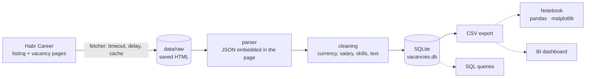
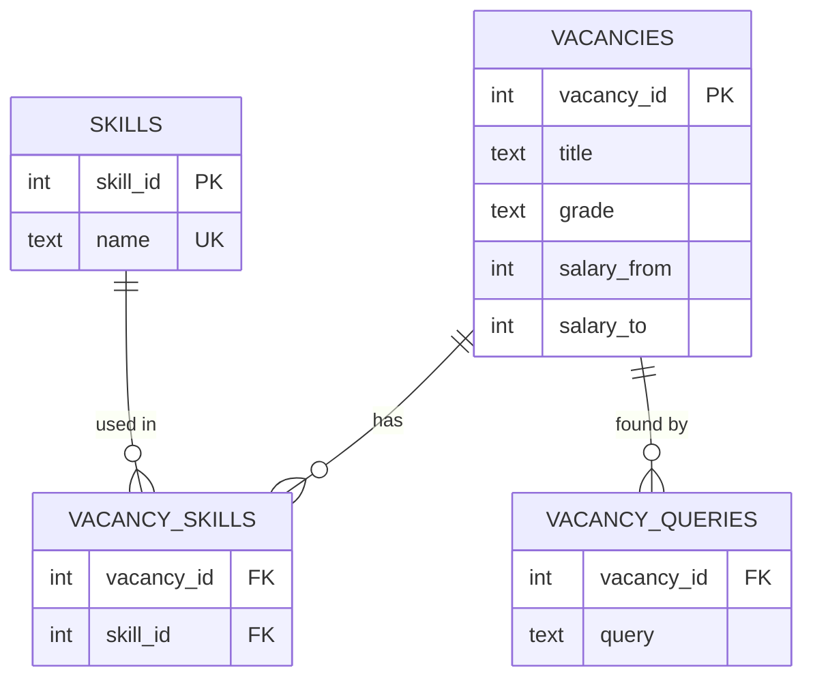

<div align="center">

# 📊 habr-vacancies

**What does the analytics job market actually pay, and which skills does it ask for?**
A reproducible pipeline that scrapes [Habr Career](https://career.habr.com) vacancies, cleans them, stores them in SQLite and turns them into answers with SQL, pandas and a BI dashboard.


[Why](#why-this-project) · [Findings](#key-findings) · [How it works](#how-it-works) · [Quick start](#quick-start) · [Data model](#data-model) · [Roadmap](#roadmap)

</div>

---

## Why this project

Job boards show vacancies one at a time. This project collects them into one clean dataset so you can ask questions the website can't answer:

- How much do analysts earn at each grade (Junior → Lead)?
- Which skills appear in the most vacancies, and which come with higher pay?
- How many employers actually disclose a salary?
- Remote vs. office: does it change the offer?

Every number can be traced back to a saved HTML page, and re-running the pipeline never requests a page it already has.

## Key findings

> 🚧 **Placeholder: fill this section from the notebook once the analysis is done.**
> Put 3–5 headline numbers here, each with its sample size, e.g.
> *"Median salary for Middle analysts: X ₽ (n = N vacancies with a disclosed salary)."*

| Question | Answer | Sample |
| --- | --- | --- |
| Median salary by grade | _TBD_ | _n = ?_ |
| Top 5 skills | _TBD_ | _n = ?_ |
| Share of vacancies with a disclosed salary | _TBD_ | _n = ?_ |

<!-- Add 1–2 charts from reports/figures/ and a screenshot of the BI dashboard from dashboards/ -->

## How it works



Solid arrows are implemented, dotted ones are planned. `pipeline.py` is the only module that calls the others: the fetcher knows nothing about HTML, the parser knows nothing about the network, and storage knows nothing about the website.

### Design decisions worth a look

- **Vacancy pages are parsed from embedded JSON, not CSS classes.** Each vacancy page ships its data as JSON inside a `script` tag. Reading that is more stable than chasing class names that change with every redesign.
- **Raw HTML is cached on disk.** Re-parsing after a code change costs zero requests, and the saved pages are the source of truth.
- **Idempotent writes.** Vacancies are upserted by `vacancy_id`, so re-running the pipeline never creates duplicates.
- **Estimated salary is kept apart from the real one.** For vacancies without a salary the site shows a calculator-based estimate. It goes into separate columns (`predicted_salary_*`) so it can never leak into salary statistics.
- **Skills come from two sources.** The structured skill list of the vacancy is merged with skills found in the description text through an external alias dictionary. Matching is by whole word, so `R` does not match inside `Redis`.
- **Clean values out of the box.** Descriptions are converted to plain text, currency codes are normalized (`RUR` → `RUB`) and salaries are stored as integers.

### Skills dictionary

`data/dictionaries/skills_dictionary.json` maps a canonical skill name to the spellings that should count as that skill. New spellings are added to the JSON file, not to the code:

```json
{
  "power bi": ["power bi", "powerbi", "пауэр би"]
}
```

## Quick start

```bash
git clone https://github.com/EidenVI/habr-vacancies.git
cd habr-vacancies

python -m venv .venv
source .venv/bin/activate          # Windows: .venv\Scripts\activate
pip install -r requirements.txt

cp .env.example .env               # then edit the values
python src/pipeline.py
```

Start with `MAX_PAGES=1` while testing: the first run downloads every page, later runs read them from the cache.

### Configuration

Settings live in `.env` (never committed; `.env.example` shows the keys).

| Variable | Meaning |
| --- | --- |
| `BASE_URL` | Site root, used to build absolute vacancy links |
| `URL_ANALYTICS_TEMPLATE` | Listing URL for the analytics category, with a `{page}` placeholder |
| `URL_TEMPLATE` | Generic listing URL with a `{page}` placeholder |
| `VACANCY_URL_TEMPLATE` | Vacancy page URL with a `{vacancy_id}` placeholder |
| `MAX_PAGES` | How many listing pages to read |
| `DATABASE_PATH` | SQLite file, e.g. `data/vacancies.db` |
| `OUTPUT_CSV_PATH` | File for the `vacancies` CSV export, e.g. `data/processed/vacancies.csv`; `skills.csv`, `vacancy_skills.csv` and `vacancy_queries.csv` are written next to it |

### Take a first look at the data

```bash
sqlite3 data/vacancies.db "SELECT COUNT(*) FROM vacancies;"
```

Vacancies per grade and how many of them disclose a salary:

```sql
SELECT grade,
       COUNT(*)                                   AS vacancies,
       SUM(salary_from IS NOT NULL
           OR  salary_to IS NOT NULL)             AS with_salary
FROM vacancies
GROUP BY grade
ORDER BY vacancies DESC;
```

Ten most requested skills:

```sql
SELECT s.name AS skill, COUNT(*) AS vacancies
FROM vacancy_skills vs
JOIN skills s ON s.skill_id = vs.skill_id
GROUP BY s.skill_id
ORDER BY vacancies DESC
LIMIT 10;
```

## Data model

One row per vacancy in the `vacancies` table:

| Column | Type | Notes |
| --- | --- | --- |
| `vacancy_id` | INTEGER, PK | taken from the site |
| `url`, `title` | TEXT | required |
| `company`, `grade`, `city`, `employment` | TEXT | `NULL` if missing |
| `is_remote` | INTEGER | 1, 0 or `NULL` |
| `salary_from`, `salary_to` | INTEGER | salary stated by the employer |
| `salary_currency` | TEXT | normalized, e.g. `RUB` |
| `predicted_salary_from`, `predicted_salary_to` | INTEGER | the site's estimate, **not** a real salary |
| `published_at` | TEXT | ISO date |
| `description` | TEXT | plain text |
| `scraped_at` | TEXT | when the page was parsed |

Missing values are stored as `NULL`, never as `0` or an empty string. The schema lives in [`sqlite.sql`](sqlite.sql).

Skills are normalized: each skill is stored once in `skills`, and `vacancy_skills` links skills to vacancies (many-to-many). That makes "top skills" a plain `JOIN` + `GROUP BY` and lets BI tools use them directly. `vacancy_queries` records which search query found a vacancy and will be filled once several specializations are collected.



Only key columns are shown in the diagram; the full list is in the table above. Foreign keys use `ON DELETE CASCADE`, and every connection enables `PRAGMA foreign_keys` so the database enforces them.

## Project structure

```text
habr-vacancies/
├── src/
│   ├── models.py        # Vacancy dataclass
│   ├── fetcher.py       # downloads pages: cache, timeout, delay
│   ├── parser.py        # HTML -> Vacancy
│   ├── cleaning.py      # salary, currency, skills, description text
│   ├── storage.py       # SQLite upsert, CSV export
│   └── pipeline.py      # runs the steps in order
├── data/
│   ├── dictionaries/    # skills_dictionary.json (alias -> skill)
│   ├── raw/             # saved HTML (listings/, vacancies/), git-ignored
│   └── processed/       # CSV export for pandas and BI
├── sqlite.sql           # database schema
├── tests/               # saved pages for parser checks
├── docs/                # notes on the site structure
├── notebooks/           # analysis (planned)
├── sql/                 # analytical queries (planned)
├── reports/figures/     # charts for this README (planned)
└── dashboards/          # BI screenshots and project file (planned)
```

## Tech stack

| Layer | Tools |
| --- | --- |
| Collection | `requests`, `BeautifulSoup` + `lxml`, `fake-headers`, `python-dotenv` |
| Storage | SQLite (`sqlite3`), plain SQL |
| Processing | `pandas` |
| Planned | `numpy`, `matplotlib`, a BI tool for the dashboard |

## Limitations (read before trusting the numbers)

- The dataset is a **snapshot** of one site on the date in `scraped_at`, not the whole market.
- **Many vacancies do not disclose a salary.** Salary statistics describe only those that do, and they may differ from the rest.
- Salaries are compared **within one currency** (RUB by default).
- Skills found in descriptions depend on the dictionary: a skill missing from it is not detected.
- Every statistic is reported together with its sample size; small groups are not interpreted.

## Responsible scraping

This is an educational project. It reads only public pages, waits between requests, caches everything it downloads, and collects no personal data. Check the site's `robots.txt` and terms of use before running it, and keep the request volume low. The scraped content belongs to its authors, so raw HTML and the database are not published in this repository.

## Roadmap

- [x] Fetcher with on-disk cache, timeout and delay
- [x] Listing and vacancy parsers (embedded JSON)
- [x] `Vacancy` model, cleaning and the skills dictionary
- [x] SQLite storage with idempotent upsert and CSV export
- [x] Normalized `skills` / `vacancy_skills` tables
- [ ] Several specializations (data, BI, product, system analyst)
- [ ] Logging and skipping of broken pages
- [ ] Analysis notebook (salary by grade, top skills, remote vs office)
- [ ] SQL queries cross-checked against pandas
- [ ] BI dashboard with filters
- [ ] Parser tests on saved pages

## Contributing

Issues and pull requests are welcome, especially new entries for the skills dictionary, analysis ideas or parser edge cases.

## License

Code is released under the [MIT License](LICENSE).